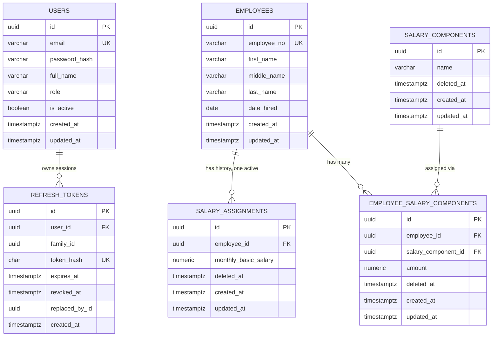

# PRD: Employee Onboarding and Salary Management System

| | |
|---|---|
| **Source** | DIWA Learning practical examination |
| **Status** | Draft v0.5 (Prisma, business rules, repo structure) |
| **Stack** | React JS (Vite), NestJS, Prisma ORM, PostgreSQL, JWT (access + refresh tokens) |
| **Repo** | Monorepo: `frontend/` and `backend/` |
| **Date** | 2026-11-13 |

---

## 1. Overview

A small HR/payroll-style web app, protected by JWT authentication (short-lived access token plus rotating refresh token), with four integrated modules: onboard employees, assign each a monthly basic salary, manage dynamic salary components per employee, and compute salary rates (annual, daily, hourly, per-minute) in Philippine Peso.

### Goals
- Four modules working end to end on one shared database, not four separate demos.
- Correct, validated data: no duplicate Employee IDs, no negative amounts, no duplicate active components per employee.
- Salary components fully dynamic (no hardcoded list) with soft delete.
- Accurate, transparent computation breakdown.
- Every API route except login/refresh requires a valid access token; sessions stay alive silently via refresh and can be revoked on logout.

### Non-goals (for the exam scope)
- Role-based permissions (single role for now), SSO/OAuth, MFA, password reset by email, payroll runs, taxes/government contributions, payslips, attendance, multi-currency.

### Primary user
HR staff / admin (single role).

---

## 2. Modules and Requirements

### Module 0: Authentication (JWT access + refresh tokens)

**Token design**

| | Access token | Refresh token |
|---|---|---|
| Purpose | Authorize API calls | Obtain a new access token |
| Lifetime | 15 minutes (configurable) | 7 days (configurable) |
| Format | Signed JWT (`sub`, `email`, `iat`, `exp`) | Signed JWT with `sub`, `jti`, `family` (different secret from access) |
| Client storage | JavaScript memory only (not localStorage) | `httpOnly`, `Secure`, `SameSite=Strict` cookie, `Path=/api/auth` |
| Sent as | `Authorization: Bearer <token>` | Cookie, automatically, only to `/api/auth/*` |
| Server storage | None (stateless) | **SHA-256 hash** stored in DB (never the raw token) |

**Functional requirements**
- FR-0.1 Login with email and password; returns an access token in the body and sets the refresh cookie.
- FR-0.2 Refresh: valid refresh cookie returns a new access token **and a new refresh token** (rotation); the old refresh token is marked used/revoked.
- FR-0.3 Reuse detection: if an already-rotated refresh token is presented, revoke the whole token family (all sessions from that login) and force re-login.
- FR-0.4 Logout: revoke the current refresh token and clear the cookie.
- FR-0.5 `GET /auth/me` returns the current user (used to restore the session on page reload via refresh).
- FR-0.6 All routes are protected by a global `JwtAuthGuard`; only routes marked `@Public()` (login, refresh) are open.
- FR-0.7 Passwords hashed with argon2id (or bcrypt, cost ≥ 12); never logged or returned.
- FR-0.8 Login rate-limited (e.g. 5 attempts/min per IP+email) with a generic "Invalid email or password" message.
- FR-0.9 Expired/invalid tokens return `401`; the frontend handles it silently (see section 6).
- FR-0.10 Expired refresh tokens are purged by a scheduled cleanup job.

**Acceptance criteria**
- Calling any `/employees`, `/salary...` endpoint without a token returns `401`.
- An access token older than 15 minutes is rejected; the UI transparently refreshes and retries once, and the user notices nothing.
- Using the same refresh token twice (replay) revokes the family; the next refresh from either client fails with `401` and the user lands on the login page.
- After logout, the old refresh token no longer works even if copied before logout.
- The refresh token is never readable from JavaScript (`document.cookie` does not show it).
- Access and refresh tokens are signed with **different secrets**, so one cannot be used as the other.

---

### Module 1: Employee Onboarding

**Fields**

| Field | Type | Required | Rules |
|---|---|---|---|
| Employee ID (`employee_no`) | string | Yes | Unique, trimmed, case-insensitive uniqueness; immutable after creation |
| First Name | string | Yes | 1–100 chars |
| Middle Name | string | No | 0–100 chars |
| Last Name | string | Yes | 1–100 chars |
| Date Hired | date | Yes | Valid date; not in the future (assumption) |

**Functional requirements**
- FR-1.1 Add a new employee.
- FR-1.2 Update employee information (Employee ID locked on edit).
- FR-1.3 Validate required fields on client and server.
- FR-1.4 Reject duplicate Employee IDs (DB unique constraint plus friendly `409` error shown inline).
- FR-1.5 List employees (table, searchable) so the other modules can reuse it.

**Acceptance criteria**
- Submitting with empty First/Last Name or Date Hired shows field-level errors and does not call the API (and the API rejects it anyway with `400`).
- Creating `EMP-001` twice returns `409 Conflict`; UI shows "Employee ID already exists".
- Editing an employee never changes its Employee ID.

---

### Module 2: Employee Salary Assignment

**Functional requirements**
- FR-2.1 Display the employee list with current basic salary (or "Not assigned").
- FR-2.2 Select an employee.
- FR-2.3 Assign a monthly basic salary.
- FR-2.4 Adjust an already assigned basic salary. An adjustment **soft deletes the current salary record** (sets `deleted_at`) and **inserts a new record** with the new amount, all in one transaction. Old rows are never overwritten or hard deleted, so the salary history is preserved.
- FR-2.5 Display the employee's current basic salary (the one active row where `deleted_at IS NULL`). Optionally show a read-only history list of previous salaries with the date each was replaced.
- FR-2.6 Validate: required, numeric, greater than 0 (see Open Question Q3 about zero), max 2 decimal places, sane upper bound (e.g. ≤ 99,999,999.99).

**Acceptance criteria**
- Negative, non-numeric, empty, or 3+ decimal inputs are rejected with clear messages.
- One employee has at most one **active** basic salary. Adjusting it soft deletes the old row and creates a new active one; the old row stays in the database.
- Adjusting to the same amount as the current salary is rejected or treated as no change (no pointless history rows).
- If the soft delete or the insert fails, neither is applied (transaction).
- Computation (Module 4) always uses the active row only.
- Currency shown as `₱` with thousands separators.

---

### Module 3: Salary Components Management

A salary component is a user-created name (e.g. "Rice Allowance", "Transportation") with an amount per employee. There is **no fixed list**.

**Functional requirements**
- FR-3.1 Display employee list; select an employee.
- FR-3.2 Show that employee's active components (name + amount).
- FR-3.3 Create a new component name on the fly while adding it to an employee.
- FR-3.4 Reuse an existing component name for other employees (autocomplete/combobox of existing names + "create new").
- FR-3.5 Add multiple components to one employee, each with its own amount.
- FR-3.6 Update an assigned component's amount.
- FR-3.7 Rename a component (see Q5 for global vs per-employee behavior).
- FR-3.8 Remove a component from an employee's assignment (soft delete the assignment row).
- FR-3.9 Soft delete a component (sets `deleted_at`; row stays in DB).
- FR-3.10 Prevent a duplicate **active** component for the same employee (case-insensitive name match).
- FR-3.11 Validate: name required (1–100 chars), amount required, numeric, ≥ 0, 2 decimals.

**Acceptance criteria**
- Adding "Rice Allowance" twice to the same employee is blocked; adding it to a different employee works.
- After removing "Rice Allowance" from an employee, it can be added again (the active-only uniqueness allows it).
- Soft-deleted records never appear in lists or computations but remain in the database.
- Names differing only by case or surrounding spaces count as duplicates.

---

### Module 4: Salary Rate Computation

**Formulas** (from the spec)

| Description | Formula |
|---|---|
| Annual Salary | Monthly Salary × 12 |
| Daily Rate | Annual Salary ÷ 314 |
| Hourly Rate | Daily Rate ÷ 8 |
| Per-Minute Rate | Hourly Rate ÷ 60 |

**Functional requirements**
- FR-4.1 Display employee list; select an employee.
- FR-4.2 Retrieve the assigned basic salary and active components.
- FR-4.3 Auto-compute annual, daily, hourly, and per-minute rates.
- FR-4.4 Show the breakdown: basic salary, each component, total monthly salary.
- FR-4.5 Recalculate automatically when the basic salary (or components) change.
- FR-4.6 Display all amounts in Philippine Peso (₱). Divisor is 314 (constant, configurable in code, not user-editable).
- FR-4.7 If the employee has no basic salary, show an empty state with a link to Module 2.

**Worked example** (assumes Monthly Salary = basic + additive components, see Q1)

Basic ₱30,000 + Rice ₱2,000 + Transport ₱1,500 = **₱33,500 monthly**

| Rate | Calculation | Result |
|---|---|---|
| Annual | 33,500 × 12 | ₱402,000.00 |
| Daily | 402,000 ÷ 314 | ₱1,280.25 |
| Hourly | 1,280.25 ÷ 8 | ₱160.03 |
| Per-minute | 160.03 ÷ 60 | ₱2.67 |

(Values rounded for display only; see rounding rule below.)

**Rounding rule (proposed):** compute at full precision using a decimal library, round to 2 decimals only for display. Do not compute hourly from the already-rounded daily. Per-minute is small, so consider displaying 4 decimals.

---

## 3. Key Assumptions and Open Questions

Brainstorm these before coding. Items marked ⭐ are the ones a panel interviewer is most likely to probe.

| # | Question | Proposed default |
|---|---|---|
| Q1 ⭐ | Do components **add to** the monthly salary, or can some be deductions? The spec says "total" and non-negative amounts, which implies additive only. | Additive only. Optionally mention a `type` (earning/deduction) field as a future extension. |
| Q2 ⭐ | Are rates computed from **basic only** or **basic + components**? Spec says "based on monthly basic salary and components". | Use total (basic + components) as "Monthly Salary" in the formulas. Also show basic-only rates as a secondary view if time allows. |
| Q3 | Can basic salary be 0? "Prevent invalid or negative" does not say. | Must be > 0 for basic; component amounts may be ≥ 0. |
| Q4 ⭐ | Salary history: overwrite or keep history? | **Keep history via soft delete.** Adjusting salary soft deletes the active row and inserts a new one. Optional later: add an `effective_date` column if raises must take effect on a future date. |
| Q5 | Renaming a component: change it everywhere or just for one employee? | Component is a shared catalog entry, so rename is global. State this in the UI ("Applies to all employees using it"). |
| Q6 | Soft delete scope: "remove from employee" vs "delete the component entirely". | Both exist. Remove = soft delete the assignment. Delete component = soft delete the catalog row and hide it from all employees' active lists. |
| Q7 | Restore of soft-deleted items? | Out of scope; data retained for audit. |
| Q8 | Can Date Hired be in the future (pre-boarding)? | Disallow, to keep validation simple. |
| Q9 | 314 working days: fixed constant or setting? | Constant in a shared config file, documented. |
| Q10 ⭐ | Who creates user accounts? Is there public signup? | No public signup. Seed one admin/HR user via a seed script; optional admin-only `POST /users` later. |
| Q11 | Are there roles (admin vs viewer)? | Single role for the exam. Keep a `role` column so a `RolesGuard` can be added without a migration. |
| Q12 ⭐ | Where do tokens live in the browser? | Access token in memory, refresh token in httpOnly cookie. Trade-off: reload needs one `/auth/refresh` call to restore the session, but XSS cannot steal a long-lived token. |
| Q13 | Concurrent sessions (multiple devices)? | Allowed. Each login creates its own token family, so logging out one device does not kill the others. |
| Q15 | Deleting a component that is still assigned: block or cascade? | Cascade: soft delete the component and all its active assignments in one transaction. State this in the README. |
| Q14 | Token lifetimes? | Access 15 min, refresh 7 days, absolute session cap optional. |

---

## 4. Data Model

### Tables

**employees**
- `id` UUID PK
- `employee_no` VARCHAR(50) NOT NULL, unique (case-insensitive). This is the business ID shown to users as "Employee ID" (e.g. `EMP-001`). Named `employee_no` so it is not confused with the `employee_id` foreign keys in other tables.
- `first_name` VARCHAR(100) NOT NULL
- `middle_name` VARCHAR(100) NULL
- `last_name` VARCHAR(100) NOT NULL
- `date_hired` DATE NOT NULL
- `created_at`, `updated_at` TIMESTAMPTZ

**salary_assignments** (one **active** basic salary per employee, older ones kept as history)
- `id` UUID PK
- `employee_id` UUID FK → employees.id, NOT NULL (not unique on its own)
- `monthly_basic_salary` NUMERIC(12,2) NOT NULL, CHECK > 0
- `deleted_at` TIMESTAMPTZ NULL (soft delete; set when the salary is adjusted)
- `created_at`, `updated_at` TIMESTAMPTZ
- **Partial unique index** on `(employee_id)` where `deleted_at IS NULL`, so an employee can never have two active salaries, while any number of soft-deleted ones can exist

**salary_components** (shared catalog of names, fully dynamic)
- `id` UUID PK
- `name` VARCHAR(100) NOT NULL
- `deleted_at` TIMESTAMPTZ NULL (soft delete)
- `created_at`, `updated_at` TIMESTAMPTZ
- Partial unique index on `lower(trim(name))` where `deleted_at IS NULL`

**employee_salary_components** (junction: employee × component × amount)
- `id` UUID PK
- `employee_id` UUID FK → employees.id NOT NULL
- `salary_component_id` UUID FK → salary_components.id NOT NULL
- `amount` NUMERIC(12,2) NOT NULL, CHECK ≥ 0
- `deleted_at` TIMESTAMPTZ NULL (soft delete)
- `created_at`, `updated_at` TIMESTAMPTZ
- **Partial unique index** on `(employee_id, salary_component_id)` where `deleted_at IS NULL` (this is what enforces "no duplicate active component per employee" and still lets a removed one be re-added)

> Use `NUMERIC`, never `FLOAT`, for money. Enforce uniqueness and checks in the database, not only in app code.

**users**
- `id` UUID PK
- `email` VARCHAR(255) NOT NULL, unique (case-insensitive)
- `password_hash` VARCHAR NOT NULL
- `full_name` VARCHAR(150) NOT NULL
- `role` VARCHAR(30) NOT NULL DEFAULT 'admin'
- `is_active` BOOLEAN NOT NULL DEFAULT true
- `created_at`, `updated_at` TIMESTAMPTZ

**refresh_tokens** (server-side record for rotation, reuse detection, revocation)
- `id` UUID PK (this is the token's `jti`)
- `user_id` UUID FK → users.id NOT NULL
- `family_id` UUID NOT NULL (shared by every token descended from one login)
- `token_hash` CHAR(64) NOT NULL, unique (SHA-256 of the raw token)
- `expires_at` TIMESTAMPTZ NOT NULL
- `revoked_at` TIMESTAMPTZ NULL
- `replaced_by_id` UUID NULL (points to the next token in the chain)
- `user_agent` VARCHAR NULL, `ip_address` VARCHAR NULL
- `created_at` TIMESTAMPTZ
- Index on `(user_id)` and `(family_id)`; index on `expires_at` for cleanup

> The auth tables are separate from the HR domain tables. `users` are system logins, `employees` are the people being onboarded; do not merge them.

### ERD



---

## 4a. Repository and Backend Structure

```
employee-salary-management/
├── docs/                   PRD.md, erd.pdf
├── frontend/               React (Vite)
├── backend/
│   ├── prisma/             schema.prisma, migrations/, seed.ts
│   ├── src/
│   │   ├── common/         guards (JwtAuthGuard), @Public(), filters, pipes
│   │   ├── config/         env validation (fail fast on missing secrets)
│   │   ├── prisma/         PrismaService, PrismaModule
│   │   └── modules/
│   │       ├── auth/
│   │       ├── users/
│   │       ├── employees/
│   │       ├── salary/
│   │       ├── salary-components/
│   │       └── computation/
│   ├── .env / .env.example
│   └── package.json
├── docker-compose.yml      PostgreSQL
└── README.md
```

**Prisma notes**
- Use `@map` / `@@map` so the database stays snake_case (`employee_no`, `deleted_at`) while code uses camelCase (`employeeNo`, `deletedAt`).
- Money fields: `Decimal @db.Decimal(12, 2)`; compute with `decimal.js`.
- Prisma's schema cannot express partial unique indexes. Generate the migration with `prisma migrate dev --create-only`, then add the three `CREATE UNIQUE INDEX ... WHERE "deleted_at" IS NULL` statements (section 4b) to the migration SQL by hand. Keep a test that proves a duplicate active row is rejected.
- Soft delete filtering: one Prisma client extension (or one shared helper) adds `deletedAt: null` to reads, so the filter is never forgotten.
- Seed: `npx prisma db seed` creates the admin user and sample employees.

---

## 4b. Soft Delete Strategy and Business Rules

**Strategy:** a nullable `deleted_at` timestamp (tombstone) on `salary_assignments`, `salary_components` and `employee_salary_components`. A row is active when `deleted_at IS NULL`. Rows are never physically removed. Partial unique indexes apply uniqueness to active rows only, so deleted rows never block new ones. Salary works as an append-only history. Components are soft deleted at two levels: the catalog name and the employee assignment.

**Why not an archive table:** it moves rows (closer to a hard delete), complicates foreign keys, and needs more code. A timestamp keeps relations intact, records when the delete happened, and allows restore by clearing it.

**Known trade-offs:** every query must filter `deleted_at IS NULL` (centralized in one place and tested); salary "deleted" really means "superseded" (upgrade path: `effective_date` columns); partial indexes live in hand-written migration SQL.

**Partial unique indexes**

```sql
CREATE UNIQUE INDEX uq_active_salary_per_employee
  ON salary_assignments (employee_id) WHERE deleted_at IS NULL;

CREATE UNIQUE INDEX uq_active_component_name
  ON salary_components (lower(trim(name))) WHERE deleted_at IS NULL;

CREATE UNIQUE INDEX uq_active_component_per_employee
  ON employee_salary_components (employee_id, salary_component_id) WHERE deleted_at IS NULL;
```

**Rule workflows**

| Rule | Workflow |
|---|---|
| Adjust salary | Validate (required, > 0, 2 decimals) → employee exists (`404`) → transaction: find active row → same amount? return no change → set old `deleted_at` → insert new row → commit (rollback on any failure). |
| Add component to employee | Validate amount (≥ 0) and name (trim, 1–100) → reuse existing active name (case-insensitive) or create it → already active for this employee? `409` → insert assignment → return list. |
| Remove component from employee | Row belongs to employee and is active (`404` otherwise) → set assignment `deleted_at`. Catalog name untouched; the component can be re-added. |
| Delete component entirely | Transaction: set catalog `deleted_at` and soft delete all its active assignments (so totals stay correct). |
| Rename component | New name must not collide with another active name (`409`) → update. Applies to all employees using it (UI says so). |
| Duplicate Employee ID | Normalize (trim, case-insensitive) → insert → map unique violation to `409`. Rely on the DB error, not a pre-check, to avoid races. |
| Computation | Load active salary and active components only → no salary? empty state → compute in decimals → round for display only. |

**Where each rule is enforced**

| Rule | Frontend | DTO / service | Database |
|---|---|---|---|
| Required fields | Zod | `class-validator` | `NOT NULL` |
| No negative salary or amount | Zod | DTO | `CHECK` |
| No duplicate Employee ID | inline error | map to `409` | unique index |
| One active salary per employee | n/a | transaction | partial unique index |
| No duplicate active component | inline error | check, then `409` | partial unique index |
| Soft delete only | confirm dialog | set `deleted_at` | no hard deletes |

The database is the final guard, the service gives readable errors, and the frontend gives fast feedback.

---

## 5. API Design (NestJS, REST, prefix `/api`)

| Method | Endpoint | Auth | Purpose |
|---|---|---|---|
| POST | `/auth/login` | Public | Email + password → access token (body) + refresh cookie |
| POST | `/auth/refresh` | Public (needs refresh cookie) | Rotate refresh token, issue new access token |
| POST | `/auth/logout` | Access token | Revoke current refresh token, clear cookie |
| GET | `/auth/me` | Access token | Current user |
| GET | `/health` | Public | Checks the API can reach the database (`SELECT 1`) |
| GET | `/users/me` | Access token | Signed-in user (never includes the password hash) |
| PATCH | `/users/me` | Access token | Update own `fullName`; change password with `currentPassword` + `newPassword` (8 to 72 chars) |

Login and refresh return `{ accessToken, user }` in the body. Logout returns `204`. There is no user list, create or delete endpoint (Q10): the admin is created by `npm run seed`, and user management is out of scope until requested. A deactivated user (`is_active = false`) cannot log in, use an access token or refresh.

All endpoints below require `Authorization: Bearer <access token>`.

| Method | Endpoint | Purpose |
|---|---|---|
| GET | `/employees` | List employees (with current basic salary) |
| POST | `/employees` | Create employee (`409` on duplicate ID) |
| GET | `/employees/:id` | Get one employee |
| PATCH | `/employees/:id` | Update employee (ID immutable) |
| PUT | `/employees/:id/salary` | Assign or adjust basic salary (soft deletes the active row, inserts a new one, in a transaction) |
| GET | `/employees/:id/salary` | Get active basic salary |
| GET | `/employees/:id/salary/history` | List previous (soft-deleted) salaries, newest first |
| GET | `/salary-components` | List active component names (for autocomplete) |
| POST | `/salary-components` | Create component name |
| PATCH | `/salary-components/:id` | Rename component |
| DELETE | `/salary-components/:id` | Soft delete component |
| GET | `/employees/:id/components` | List employee's active components |
| POST | `/employees/:id/components` | Add component (body: existing `componentId` or new `name`, plus `amount`) |
| PATCH | `/employees/:id/components/:ecId` | Update amount |
| DELETE | `/employees/:id/components/:ecId` | Soft delete assignment |
| GET | `/employees/:id/computation` | Computed rates and breakdown |

**Auth implementation notes (NestJS)**
- `@nestjs/jwt` + `@nestjs/passport` with two strategies: `jwt` (access, reads Bearer header) and `jwt-refresh` (reads cookie, uses the refresh secret).
- Register `JwtAuthGuard` as a global `APP_GUARD`; add a `@Public()` decorator that the guard checks via `Reflector`.
- Secrets in env: `JWT_ACCESS_SECRET`, `JWT_REFRESH_SECRET`, `JWT_ACCESS_TTL=15m`, `JWT_REFRESH_TTL=7d`. Fail startup if missing.
- Pin the algorithm (HS256) on both sign and verify.
- Refresh flow inside one DB transaction: look up by hash → check not expired/revoked → if already revoked, revoke family and `401` → else mark revoked, insert the new token with the same `family_id`, set `replaced_by_id`.
- CORS: explicit frontend origin with `credentials: true` (no wildcard). Cookie `Secure` in production, `SameSite=Strict`, `Path=/api/auth` so it is not sent on normal API calls.
- `@nestjs/throttler` on `/auth/login` and `/auth/refresh`; Helmet for security headers.

**Conventions:** DTOs with `class-validator` and a global `ValidationPipe` (whitelist, transform); consistent error shape `{ statusCode, message, errors[] }`; `400` validation, `404` not found, `409` duplicate; Prisma migrations (`prisma migrate`), never `db push` in the final version.

**Computation response (shape)**
```json
{
  "employee": { "id": "...", "employeeNo": "EMP-001", "name": "Juan D. Cruz" },
  "basicSalary": "30000.00",
  "components": [
    { "name": "Rice Allowance", "amount": "2000.00" },
    { "name": "Transportation", "amount": "1500.00" }
  ],
  "componentsTotal": "3500.00",
  "monthlyTotal": "33500.00",
  "annualSalary": "402000.00",
  "dailyRate": "1280.25",
  "hourlyRate": "160.03",
  "perMinuteRate": "2.67",
  "workingDaysDivisor": 314,
  "currency": "PHP"
}
```
Compute on the server (single source of truth) and return amounts as strings to avoid float drift.

---

## 6. Frontend (React JS)

**Pages / routes**

| Route | Module |
|---|---|
| `/login` | Login form (public) |
| `/employees` | Onboarding (list + add/edit form) |
| `/salary` | Salary assignment |
| `/components` | Salary components management |
| `/computation` | Rate computation |

**Auth handling**
- `AuthProvider` holds the access token in memory and the current user. On app load it calls `POST /auth/refresh`; success restores the session, failure redirects to `/login`.
- `ProtectedRoute` wraps the four module routes; unauthenticated users go to `/login` and return to their original page after login.
- Axios (or fetch) instance with `withCredentials: true`; request interceptor attaches the Bearer token.
- Response interceptor: on `401` (not from `/auth/*`), call refresh **once** using a single shared in-flight promise so parallel requests wait for the same refresh, then retry the original request. If refresh fails, clear state and go to `/login`.
- Logout button calls `/auth/logout`, clears memory state and the query cache.
- Do not store tokens in localStorage or sessionStorage.

**Shared pieces:** one employee picker component reused by Modules 2–4; a `formatPeso()` util (`Intl.NumberFormat('en-PH', { style: 'currency', currency: 'PHP' })`); form validation with React Hook Form + Zod; server state with TanStack Query so that saving in one module invalidates and refreshes the others (this is how the "integrated" and "auto-recalculate" requirements are met).

**UX states to cover:** loading, empty (no employees, no salary, no components), inline validation errors, server errors/toasts, confirm dialog before remove/soft delete.

---

## 7. Non-Functional Requirements
- **Security:** short-lived access token, rotated hashed refresh tokens, reuse detection, httpOnly cookie, separate secrets, rate-limited login, no secrets in the repo (`.env.example` only), HTTPS in production.
- **Data integrity:** DB constraints are the final guard (unique, FK, CHECK, partial unique indexes).
- **Money correctness:** NUMERIC in DB, decimal library (e.g. `decimal.js`) in code, never JS floats.
- **Validation:** same rules on client and server; server is authoritative.
- **Soft delete:** applies to salary assignments, salary components, and employee salary components. All list/compute queries filter `deleted_at IS NULL`.
- **Maintainability:** modular NestJS (one module per domain), seed script with sample employees, `.env.example`, README with run steps.
- **Deliverables:** working app, migrations, ERD image/diagram, README.

---

## 8. Test Plan (minimum)

| Area | Cases |
|---|---|
| Soft delete | duplicate active row rejected by the DB (all three indexes); deleted rows excluded from lists and computation; filter extension covers every read |
| Auth | login success/failure (generic error); protected route without token → 401; expired access token → refresh → retry succeeds; refresh rotation issues a new token and revokes the old; replaying a revoked refresh token revokes the family; logout invalidates the refresh token; tampered or wrong-secret token → 401; login rate limit triggers |
| Employees | duplicate ID → 409; missing required fields → 400; edit keeps ID |
| Salary | negative, zero, non-numeric, 3 decimals rejected; adjusting soft deletes the old row and creates a new active one; only one active row per employee (DB enforced); old rows remain in DB; same-amount adjustment handled; failed insert rolls back the soft delete |
| Components | duplicate active blocked (also with different case); re-add after remove works; same name on a second employee works; soft-deleted row remains in DB; amount < 0 rejected |
| Computation | matches worked example; changes after salary edit; no-salary empty state; component soft-delete excluded from total |
| Integration | login → create employee → assign salary → add components → computation shows correct total |

---

## 9. Milestones (suggested)

1. Prisma schema, migrations (including the three partial unique indexes), seed, ERD, NestJS skeleton.
2. Module 0 (auth: users, login, refresh rotation, logout, global guard, React login + interceptor + protected routes). Do this early so every later endpoint is built behind the guard.
3. Module 1 (employees CRUD + validation).
4. Module 2 (salary upsert).
5. Module 3 (components, soft delete, duplicate rules).
6. Module 4 (computation endpoint + UI).
7. Integration pass, edge cases, seed data (including admin user), README, demo rehearsal.

---

## 10. Interview Talking Points
- Soft delete strategy: `deleted_at` tombstone plus partial unique indexes, why not an archive table, and the trade-offs (section 4b).
- Why a catalog table plus junction table (dynamic components, reuse across employees, rename once).
- Why a partial unique index (soft delete without blocking re-add), used for both active salary per employee and active components per employee.
- Why salary adjustments soft delete and insert instead of updating in place (audit trail, history, nothing lost).
- Why NUMERIC and server-side computation (precision, single source of truth).
- Why 314 as a named constant, and the rounding policy.
- Why two tokens: a short access token limits damage if stolen, a long refresh token keeps the user logged in without re-entering a password.
- Why rotation plus reuse detection, and why only a hash of the refresh token is stored.
- Why access token in memory and refresh token in an httpOnly cookie (XSS and CSRF trade-offs).
- How parallel 401s are handled with a single in-flight refresh.
- The assumptions you made on Q1/Q2 and why, stated up front rather than discovered by the interviewer.
